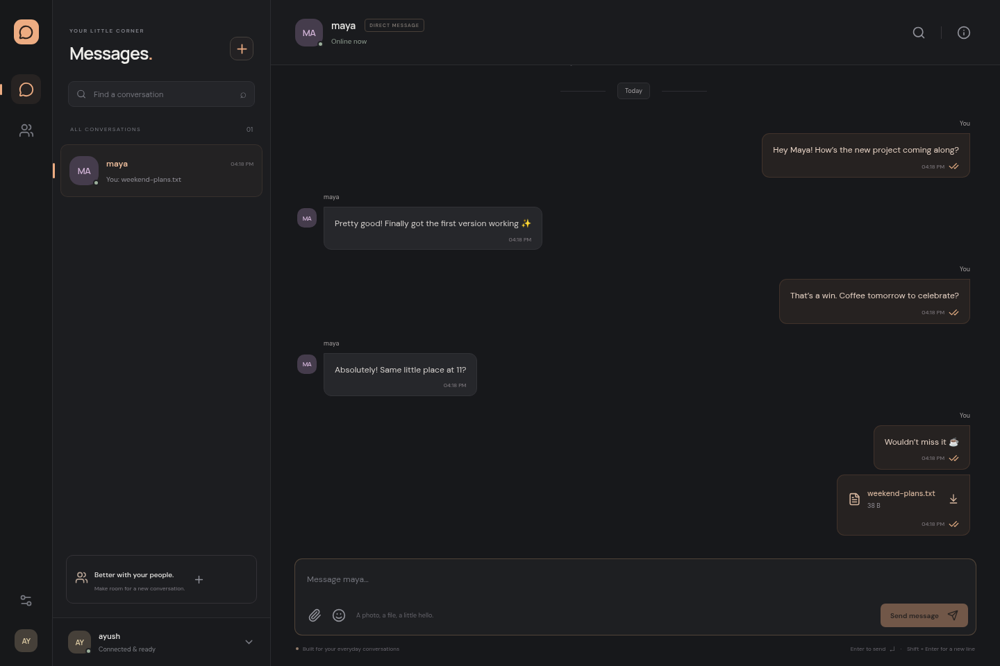

# SecureChat

A little space for your people. A responsive, real-time messenger with a charcoal and warm peach interface, recovery-phrase accounts, and signed messages.



## Run locally

Requires **Node.js 22.13+** and npm. Node 24 LTS or later is recommended.

```sh
git clone https://github.com/yadavayush834/chat_app.git
cd chat_app
npm install
npm run dev
```

Open **http://localhost:5173**. SQLite and private upload storage are created automatically in `backend/data/`; no database account or API keys are needed. Fonts and assets are served locally.

For a production build on your laptop:

```sh
npm run build
npm start
```

Open **http://localhost:5000**. Run `./scripts/install-desktop.sh` on Linux to add **SecureChat** to your application launcher.

Express serves both the app and API. The default bind address is loopback; set `HOST=0.0.0.0` to expose it on your network. For hosting, use HTTPS, set `SECURE_COOKIE=true` and `CLIENT_ORIGIN` to the actual browser origin, and preserve the writable data directory. Configure optional settings using [backend/.env.example](backend/.env.example).

## What works

- Create an account, back up its 12-word phrase, and sign in again on another device.
- Add people by username; both participants get the conversation instantly.
- Real-time direct messages, typing, presence, unread counts, and sent/delivered/seen receipts.
- Signed, idempotent message sends with visible failure and retry states.
- Images and downloadable files up to 5 MB, accessible to the two participants.
- Conversation search, search within loaded history, emoji, multiline drafts, and paginated older messages.
- Reconnection without duplicate messages, tab-aware presence, and phone navigation.

[Phone layout](docs/screenshots/chat-mobile.png) · [Account creation screen](docs/screenshots/welcome.png)

## Account and privacy model

The browser generates and restores the signing wallet. A single-use, two-minute challenge proves account ownership; an HTTP-only, SameSite session authenticates HTTP requests and sockets. Every message signs its content, recipient, attachment ID, and unique client ID. Only the recipient can update read receipts. History and files require participant authorization.

**This is not end-to-end encrypted.** The server stores readable messages and files. Private keys stay in browser session storage for the current tab; the recovery phrase is never sent to the server. Closing the tab requires the phrase to sign in again. Sign out revokes that session and its sockets. Keep the recovery phrase private; it cannot be reset.

This repair replaces the original MongoDB-only prototype with SQLite. It does not import an existing MongoDB database. Existing externally hosted data should be backed up before migrating.

## Development

```sh
npm test                 # 15 backend integration tests; isolated temporary database
npm run lint
npm run build
npx playwright install chromium  # first browser-test run only
npm run test:e2e          # two-account browser flows, mobile, attachments and recovery
```

Backend tests cover signatures, replay protection, authorization, files, pagination, presence, logout, and persistence through restart. Browser tests use independent sessions and real HTTP/Socket.IO traffic; their data is temporary. Screenshots use test accounts, not personal messages.

**Stack:** React 19, Vite, Express 5, Socket.IO, ethers, and Node’s SQLite module. [Development notes](AGENTS.md) · [ISC license](LICENSE)
